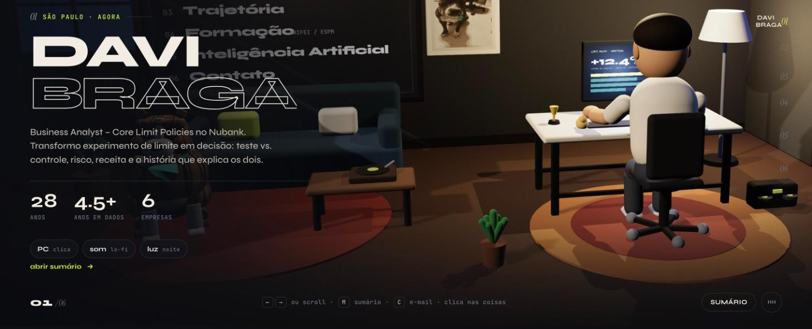
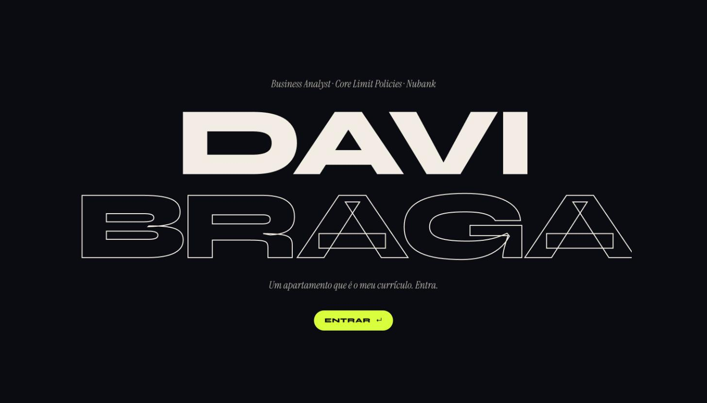
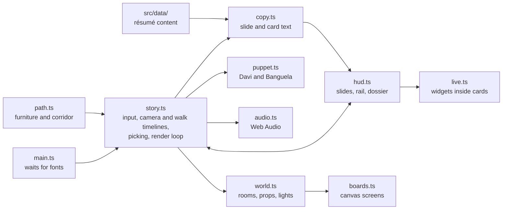

# davi-diorama

Davi Braga's résumé as an interactive 3D apartment: walk through six rooms, click the objects, read the career.

[](https://davi-diorama.vercel.app)

**[Live demo: davi-diorama.vercel.app](https://davi-diorama.vercel.app)** (the site text is in Portuguese)

[](https://davi-diorama.vercel.app)
[](LICENSE)


## What it is

davi-diorama is a résumé built as a small 3D world instead of a document. A clay-style avatar of Davi starts seated at his desk; scrolling, swiping or pressing a key walks him down a corridor from room to room (profile, Nubank, earlier jobs, education, applied AI, contact) while the camera follows. Objects in the scene open details, play sounds or react when clicked. It is a static front-end app written in TypeScript on top of Three.js, with no backend.



## Highlights

- **Walk-through navigation.** Arrow keys, space, PageUp/PageDown, the mouse wheel, a swipe or the keys 1 to 6 move between the six rooms; the section rail and the index (the board on the wall, or the M key) jump straight to one. The avatar stands up, walks the corridor and turns to face each room, driven by GSAP timelines (`src/story.ts`).
- **A scene you can poke.** The monitor cycles six screens (limit monitoring, SQL, contact, experiment, n8n flow, notebook), the floor lamp toggles a night mode, the boombox and the turntable start a lo-fi loop that makes the wall boards pulse, and the mug, plants, ball, clock, window and string lights react. The dog, Banguela, barks when clicked (typing his name works too).
- **Everything is generated in code.** The apartment, avatar and dog are built from Three.js primitives with a matte clay material, the wall screens are animated canvas textures, and all sound is synthesized with the Web Audio API. The scene uses no 3D model or audio files, only one photo (the dog's portrait on the wall).
- **Résumé as data.** Experience, education, skills, projects and thesis live in typed files in `src/data/`. Clicking a board, nameplate or chip opens a side panel (the "dossier") built from them, and some panels include small illustrations: an n8n-style flow runner, a skill before/after toggle, an MCP tool-call viewer, a knapsack picker and test-vs-control bars. The charts drawn in the scene and in these cards are animated illustrations, not company data; the experiment screen and the test-vs-control card say so in the UI.
- **Phone-friendly.** At 900 px wide or less the app uses a lighter render path (no shadows or antialiasing, capped pixel ratio), a different camera framing, swipe navigation and a bottom-sheet panel.
- **Layout guard.** The walking route is checked against the furniture footprints when the app starts (`assertWalkRoute` in `src/path.ts`) and by a standalone script, `npm run test:path`.

## How it works



`main.ts` waits for the web fonts, then `story.ts` creates the WebGL renderer, builds the scene (`world.ts`, `puppet.ts`) and binds the HUD (`hud.ts`). The story keeps one piece of state, the current room. Moving to another room plays a GSAP timeline that tweens the camera, walks the avatar along the corridor and shows the matching slide. A pointer raycast finds the object under the cursor; each pickable object carries a `{ kind, id }` tag that either runs a small reaction or asks `copy.ts` for a card to show in the dossier.

Inspiration: the diorama camera and the matte look are inspired by [david-hckh.com](https://david-hckh.com/) ([portfolio-2025](https://github.com/davidhckh/portfolio-2025)). No model or texture from that project is used here.

## Tech stack

- **3D:** Three.js r169 (WebGL)
- **Motion and input:** GSAP 3 (timelines, `quickTo`, the Observer plugin for wheel and touch)
- **Language and tooling:** TypeScript 5 (strict mode), Vite 6
- **Sound and textures:** Web Audio API and Canvas 2D, generated at runtime
- **Fonts:** Syne, Instrument Serif and JetBrains Mono (Google Fonts)
- **Hosting:** Vercel, with security headers set in `vercel.json`

## Run locally

Requires Node.js 18 or newer (a Vite 6 requirement).

```bash
git clone https://github.com/DaviBragaBA/davi-diorama.git
cd davi-diorama
npm install
npm run dev
```

The dev server runs at <http://localhost:5173>. Other scripts from `package.json`:

| Command | What it does |
| --- | --- |
| `npm run build` | Type-checks with `tsc`, then builds to `dist/` with Vite |
| `npm run preview` | Serves the production build locally |
| `npm run test:path` | Checks the walking corridor against the furniture layout |

## Project structure

```text
davi-diorama/
├── docs/                 screenshots used in this README
├── index.html            page shell: intro, slide, rail, dossier and toolbar markup
├── public/fotos/         the one photo used in the scene (the dog's portrait)
├── scripts/
│   └── check-path.mjs    corridor-vs-furniture check (npm run test:path)
├── src/
│   ├── main.ts           entry point: waits for fonts, starts the story
│   ├── story.ts          input, camera and walk timelines, picking, render loop
│   ├── world.ts          rooms, furniture, lights and pickable objects
│   ├── puppet.ts         the clay avatar (Davi) and the dog (Banguela)
│   ├── boards.ts         canvas-textured wall boards and screens
│   ├── clay.ts           materials, geometry helpers and the palette
│   ├── hud.ts            slides, section rail, dossier panel and toasts
│   ├── copy.ts           slide and card text built from the data files
│   ├── live.ts           small interactive widgets inside dossier cards
│   ├── audio.ts          Web Audio: lo-fi loop and sound effects
│   ├── path.ts           furniture footprints and the walking corridor
│   ├── data/             résumé content: experience, education, skills, projects, thesis
│   └── style.css         HUD, dossier and responsive styles
├── vercel.json           security headers
└── SECURITY.md, CONTRIBUTING.md, AGENTS.md, LICENSE
```

## Author

**Davi Braga**, Business Analyst at Nubank · Software engineer in applied AI

- Portfolio: [davi-braga-portfolio.vercel.app](https://davi-braga-portfolio.vercel.app)
- GitHub: [@DaviBragaBA](https://github.com/DaviBragaBA)

## License

[MIT](LICENSE) © 2026 Davi Braga
