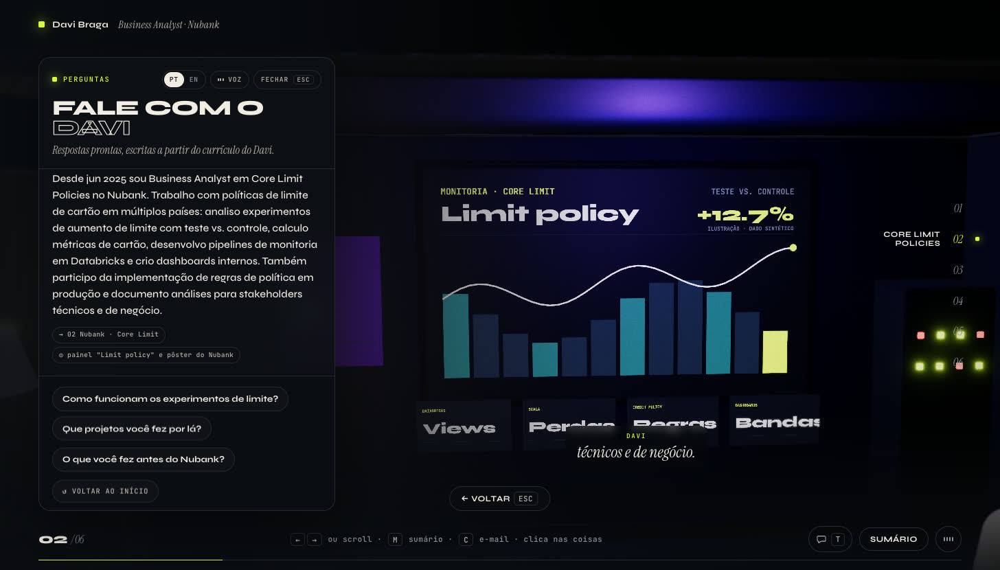
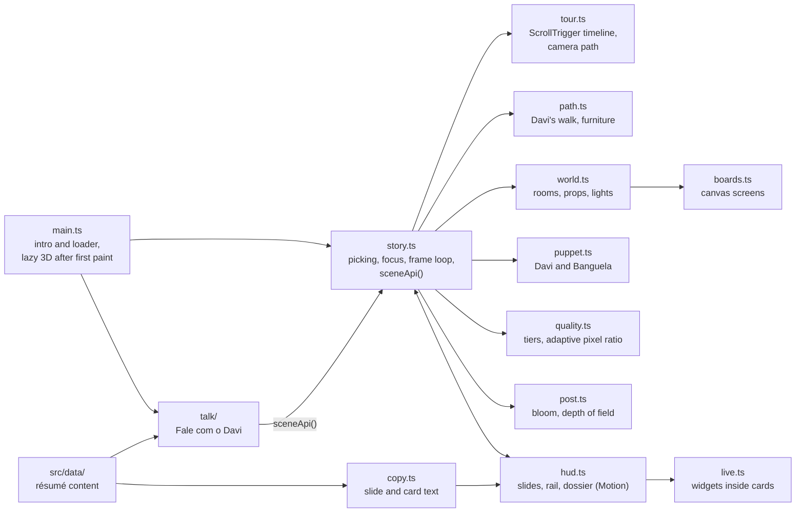

# davi-diorama

Davi Braga's résumé as an interactive 3D apartment: scroll through six rooms, click the objects, read the career, or ask Davi a ready-made question and watch the room answer.

[](https://davi-diorama.vercel.app)

**[Live demo: davi-diorama.vercel.app](https://davi-diorama.vercel.app)** (the site text is in Portuguese; the question panel also speaks English)

[](https://davi-diorama.vercel.app)
[](LICENSE)


## What it is

davi-diorama is a résumé built as a small 3D world instead of a document. A clay-style avatar of Davi starts seated at his desk; one scroll-driven tour walks him down a corridor from room to room (profile, Nubank, earlier jobs, education, applied AI, contact) while the camera follows, and every room is anchored on the object that tells that part of the story. Objects open details, play sounds or react when clicked. "Fale com o Davi" adds a guided conversation: ready-made questions with first-person answers written from the résumé data, played back while the camera and the avatar move. It is a static front-end app written in TypeScript on top of Three.js, with no backend and no AI model behind it.


## Highlights

- **One scroll tour.** Scroll, trackpad, touch, the keyboard, the section rail and the summary all move a single GSAP timeline scrubbed by ScrollTrigger over a native scroller (`src/tour.ts`). The timeline only moves one number, the tour progress; the camera rides Catmull-Rom splines through one shot per chapter and cranes up between rooms, Davi stands up, walks and sits down again as a function of that same number (`daviAt` in `src/path.ts`), so scrolling back replays everything in reverse. Labels snap to the nearest chapter, and rooms light up as the camera arrives.
- **Choreographed HUD.** [Motion](https://motion.dev) drives the text and buttons: titles rise letter by letter on a spring, the counters count up to the slide copy, chips and metrics stagger in, buttons press with a spring and the dossier slides in as a modal dialog with its own focus trap.
- **A scene you can poke.** Hover shows a label and a soft lime highlight; a click frames the object with a smooth camera move (with depth of field on the high tier) and a "voltar" button, and Esc, scroll or a click on empty space returns to the tour. The desk PC plays a live dashboard, the floor lamp toggles a night mode, the boombox and the turntable start a lo-fi loop that makes the wall boards pulse, and the mug, plants, ball, clock, window and string lights react. The dog, Banguela, barks when clicked (typing his name works too).
- **"Fale com o Davi".** A side panel (a bottom sheet on phones) with 13 ready-made questions in Portuguese and English, opened by the floating button, the chip in the toolbar or the T key. Each answer is written in the first person only from `src/data` (the tests check that every number in an answer already exists there and that no answer passes 80 words), types out with subtitles over the scene, and drives the tour through `sceneApi()` in `src/story.ts`: the camera glides to the matching chapter, frames the board it talks about, and the matching card opens; Davi turns to the viewer, talks and gestures (wave, nod, think, point). There is no text box and nothing is generated; the panel says so ("Respostas prontas, escritas a partir do currículo do Davi"). An optional voice uses the browser's own speech synthesis. While the panel is open the tour under it holds still, and Esc closes the panel first.
- **Rendering that fits the device.** `src/quality.ts` guesses a low, mid or high tier from the GPU and the device, then corrects it from real frame intervals (pixel ratio first, the tier last); `?q=low|mid|high` pins a tier. `src/post.ts` merges bloom, ACES tone mapping, vignette and grain into one pass, with depth of field as a separate pass only while an object is in focus. Static meshes are batched by material and room (189 meshes become 52 draws), and the shadow maps redraw only when something moves.
- **Fast first paint, lazy everything else.** `main.ts` paints the intro and a real progress bar; the 3D engine downloads after the first paint as its own chunk, the room is built in short tasks, shaders and textures warm up behind the intro, post-processing is another chunk, and the question panel loads on its first open.
- **Fallbacks and access.** With reduced motion, chapters cut with a short fade, Davi is placed instead of walking, counters show their final values and the question panel shows each answer at once and only highlights the chapter in the rail. Without WebGL the same résumé (slides, rail, keys, cards, questions) runs over a still of the room. On phones the room fills the top half above the card, titles shrink to fit and tap targets are 44 px. The HUD stays inert under the intro, both dialogs trap focus, and answers are announced with `aria-live`.
- **Résumé as data.** Experience, education, skills, projects and thesis live in typed files in `src/data/`. Boards, nameplates and chips open cards built from them, some with small illustrations: an n8n-style flow runner, a skill before/after toggle, an MCP tool-call viewer, a knapsack picker and test-vs-control bars. The charts in the scene and in these cards are illustrations, not company data, and the screens and cards that show a number say so.
- **Everything is generated in code.** The apartment, avatar and dog are built from Three.js primitives with a matte clay material, the wall screens are animated canvas textures and all sound is synthesized with the Web Audio API. The scene uses no 3D model or audio files, only one photo (the dog's portrait on the wall).
- **Layout guard.** The walking route is checked against the furniture footprints when the app starts (`assertWalkRoute` in `src/path.ts`), the tour is sampled in development so Davi never overlaps furniture (`assertTourClear`), and `npm run test:path` runs the corridor check on its own.



## Performance

Measured on the production build when the tour was rebuilt:

- Lighthouse mobile performance 89 → 97
- Total Blocking Time 331 → 87 ms
- Entry chunk 14.8 kB; the question panel later added 0.3 kB to it, a 2 kB loader once the room is ready and a 38 kB chunk that loads on its first open

## How it works



`main.ts` shows the intro and the loader at once, then imports `story.ts` after the first paint. The story opens one WebGL2 context, picks a quality tier, builds the room in short tasks (`world.ts`, `puppet.ts`, `batch.ts`), warms the shaders and binds the HUD (`hud.ts`). From then on a single number drives the page: ScrollTrigger maps the scroll position to the tour progress, and each frame derives the camera pose, Davi's pose, the lit room and the slide from it. A pointer raycast finds the object under the cursor; each pickable carries a `{ kind, id }` tag that runs a small reaction or asks `copy.ts` for a card.

The question panel lives in `src/talk/`. `boot.ts` adds the entry points, `panel.ts` plays the answers in `qa.ts`, and `bridge.ts` talks to the scene only through `sceneApi()` (go to a chapter, focus an object, open a card, and Davi's puppet for the talk animation). `catalog.ts` lists the chapter, object and card ids an answer may use, and anything else is ignored.

Inspiration: the diorama camera and the matte look are inspired by [david-hckh.com](https://david-hckh.com/) ([portfolio-2025](https://github.com/davidhckh/portfolio-2025)). No model or texture from that project is used here.

## Controls

| Input | What it does |
| --- | --- |
| Scroll, trackpad, swipe | Walk the tour (the wheel over the text column works too) |
| ← → ↑ ↓, Space, PageUp, PageDown | Previous or next chapter |
| Home, End, 1 to 6 | Jump to a chapter |
| Click or tap an object | Frame it and open its card or reaction |
| M | Summary |
| C | Copy the contact e-mail |
| S | Lo-fi music on and off |
| T | Open "Fale com o Davi" |
| Esc | Close the question panel, then a card, then leave the framed object |

## Tech stack

- **3D:** Three.js r169 (WebGL2) and [postprocessing](https://github.com/pmndrs/postprocessing) for bloom, tone mapping and depth of field
- **Motion and input:** GSAP 3 with ScrollTrigger and ScrollToPlugin for the tour, Motion for the HUD
- **Language and tooling:** TypeScript 5 (strict mode), Vite 6
- **Tests:** Vitest (unit) and Playwright (end-to-end, Chromium)
- **Sound, voice and textures:** Web Audio API, Web Speech API (optional voice) and Canvas 2D, all at runtime
- **Fonts:** Syne, Instrument Serif and JetBrains Mono (Google Fonts faces, inlined in the CSS)
- **Hosting:** Vercel, with security headers set in `vercel.json`

## Run locally

Requires Node.js 22.12 or newer (for Vitest; the site itself builds with Vite 6).

```bash
git clone https://github.com/DaviBragaBA/davi-diorama.git
cd davi-diorama
npm install
npm run dev
```

The dev server runs at <http://localhost:5173>. Other scripts from `package.json`:

| Command | What it does |
| --- | --- |
| `npm run build` | Type-checks with `tsc`, then builds to `dist/` with Vite |
| `npm run preview` | Serves the production build locally |
| `npm run test:path` | Checks the walking corridor against the furniture layout |
| `npm run test:unit` | Vitest: the ready-made answers (ids, follow-ups, both languages, 80 words, numbers found in `src/data`), the scene whitelist against the scene source, the bridge to `sceneApi()` and the playback helpers |
| `npm run test:e2e` | Builds, serves the build and runs Playwright at 1456x830 and 390x844: the question panel end to end, focus trap and Esc, the tour holding still under the panel, reduced motion and the no-WebGL fallback |

Before the first `npm run test:e2e`, install the browser once with `npx playwright install chromium`. The tests run the full Chromium in headless mode so WebGL renders on the GPU.

## Project structure

```text
davi-diorama/
├── docs/                 screenshots used in this README
├── index.html            page shell: intro and loader, tour scroller, slide, rail, dossier and toolbar markup
├── public/               the dog's photo, the no-WebGL still, the link preview and the icons
├── scripts/
│   └── check-path.mjs    corridor-vs-furniture check (npm run test:path)
├── src/
│   ├── main.ts           entry point: intro and loader, then the 3D chunk after the first paint
│   ├── loader.ts         the intro's progress bar, driven by real loading stages
│   ├── story.ts          picking, focus, hover, actions, the frame loop and sceneApi()
│   ├── tour.ts           the ScrollTrigger timeline and the camera path
│   ├── path.ts           furniture footprints, the corridor and Davi's walk
│   ├── world.ts          rooms, furniture, lights and pickable objects
│   ├── puppet.ts         the clay avatar (Davi) and the dog (Banguela)
│   ├── boards.ts         canvas-textured wall boards and screens
│   ├── quality.ts        quality tiers and the adaptive pixel ratio
│   ├── post.ts           post-processing (its own lazy chunk)
│   ├── batch.ts          static batching of meshes by material and room
│   ├── clay.ts           materials, geometry helpers and the palette
│   ├── hud.ts            slides, section rail, dossier, hover label and toasts
│   ├── anim.ts           the parts of Motion the HUD uses
│   ├── copy.ts           slide and card text built from the data files
│   ├── live.ts           small interactive widgets inside dossier cards
│   ├── audio.ts          Web Audio: lo-fi loop and sound effects
│   ├── talk/             "Fale com o Davi": questions and answers, panel, playback, voice, bridge to the scene
│   ├── data/             résumé content: experience, education, skills, projects, thesis
│   └── style.css         HUD, dossier and responsive styles
├── tests/                Vitest unit tests and Playwright end-to-end tests
├── vercel.json           security headers
└── SECURITY.md, CONTRIBUTING.md, AGENTS.md, LICENSE
```

## Author

**Davi Braga**, Business Analyst at Nubank · Software engineer in applied AI

- Portfolio: [davi-braga-portfolio.vercel.app](https://davi-braga-portfolio.vercel.app)
- GitHub: [@DaviBragaBA](https://github.com/DaviBragaBA)

## License

[MIT](LICENSE) © 2026 Davi Braga
